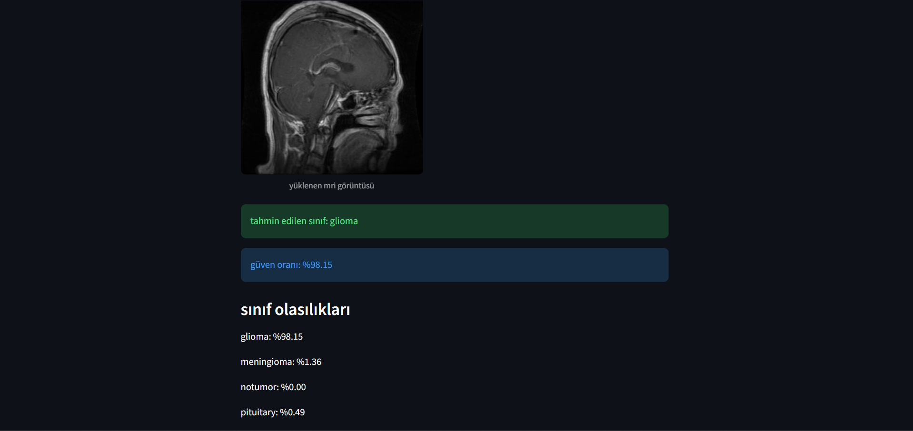
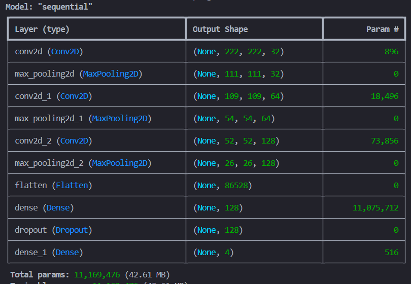

# Brain Tumor MRI Classification



## 🇹🇷 Türkçe

### Proje Hakkında
Bu proje, beyin MR görüntülerini dört sınıfa ayıran derin öğrenme tabanlı bir sınıflandırma sistemidir: **glioma, meningioma, hipofiz (pituitary) tümörü ve tümör yok**. Sıfırdan tasarlanan bir evrişimli sinir ağı (CNN) ile ImageNet üzerinde önceden eğitilmiş MobileNetV2 tabanlı bir transfer öğrenme modeli karşılaştırılmış, eğitilen model bir Streamlit web arayüzü üzerinden kullanıma sunulmuştur.

Çalışma mantığı:
1. Görüntüler sınıf klasörlerinden `image_dataset_from_directory` ile 224×224 boyutunda okunur ve piksel değerleri 0–1 aralığına ölçeklenir.
2. CNN modeli üç Conv2D + MaxPooling bloğu, yoğun (Dense) katman ve Dropout ile eğitilir.
3. MobileNetV2 modelinde temel ağ dondurulur, üzerine sınıflandırma katmanları eklenir.
4. Modeller test kümesinde doğruluk, karmaşıklık matrisi ve sınıflandırma raporu ile değerlendirilir.
5. Streamlit arayüzünde kullanıcı bir MR görüntüsü yükler; model tahmin edilen sınıfı, güven oranını ve tüm sınıf olasılıklarını gösterir.

### Özellikler
- Veri seti kontrolü, sınıf dağılımı ve örnek görüntü görselleştirmesi
- Özel CNN ve MobileNetV2 transfer öğrenme modellerinin eğitimi ve karşılaştırılması
- Doğruluk/kayıp grafikleri, karmaşıklık matrisi ve sınıflandırma raporları
- Tek görüntü için komut satırından tahmin
- Görüntü yükleyip anlık tahmin alınabilen Streamlit arayüzü

### Sonuçlar
Test kümesi: 1.600 görüntü (sınıf başına 400).

| Model | Doğruluk | Makro F1 |
| --- | --- | --- |
| Özel CNN | **0,85** | 0,84 |
| MobileNetV2 (dondurulmuş taban, 5 epoch) | 0,77 | 0,76 |

Grafikler ve raporlar [`results/`](results/) klasöründedir.

### Kullanılan Teknolojiler
Python, TensorFlow / Keras, MobileNetV2, scikit-learn, NumPy, Matplotlib, Seaborn, Pillow, Streamlit

### Kurulum
1. Depoyu klonlayın ve bağımlılıkları kurun:
   ```bash
   git clone https://github.com/afranurbasak/brain-tumor-mri-classification.git
   cd brain-tumor-mri-classification
   pip install -r requirements.txt
   ```
2. [Brain Tumor MRI Dataset (Kaggle)](https://www.kaggle.com/datasets/masoudnickparvar/brain-tumor-mri-dataset) veri setini indirin ve şu yapıya yerleştirin (veri seti boyutu nedeniyle depoda yoktur):
   ```
   veri_seti/Training/{glioma,meningioma,notumor,pituitary}
   veri_seti/Testing/{glioma,meningioma,notumor,pituitary}
   ```

### Kullanım
Komutları depo kök dizininden çalıştırın:
```bash
python src/veri_kontrol_onisleme.py         # veri seti kontrolü
python src/veri_gorsellestirme.py           # sınıf dağılımı ve örnek görseller
python src/temel_cnn_modeli.py              # CNN eğitimi -> modeller/
python src/mobilenetv2_transfer_modeli.py   # MobileNetV2 eğitimi
python src/test_verisinden_tahmin.py        # test görsellerinden tahmin
streamlit run src/streamlit_arayuz.py       # web arayüzü
```
Eğitilmiş model dosyaları (`.keras`) boyutları nedeniyle depoda bulunmaz; eğitim betikleri bunları `modeller/` klasörüne kaydeder.

### Notlar
- MobileNetV2 modeli yalnızca 5 epoch ve dondurulmuş tabanla eğitilmiştir; ince ayar (fine-tuning) ile performansın artması beklenir.
- Bu proje akademik bir çalışmadır, **tıbbi tanı aracı değildir**.
- Kod yorumları Türkçedir.

## 🇬🇧 English

### About the Project
A deep-learning system that classifies brain MRI scans into four classes: **glioma, meningioma, pituitary tumor and no tumor**. A convolutional neural network (CNN) built from scratch is compared with a MobileNetV2 transfer-learning model pre-trained on ImageNet, and the trained model is served through a Streamlit web interface.

How it works:
1. Images are loaded from class folders with `image_dataset_from_directory` at 224×224 and pixel values are rescaled to 0–1.
2. The CNN is trained with three Conv2D + MaxPooling blocks, a dense layer and dropout.
3. For MobileNetV2, the base network is frozen and classification layers are added on top.
4. Both models are evaluated on the test set with accuracy, a confusion matrix and a classification report.
5. In the Streamlit app, the user uploads an MRI image and the model shows the predicted class, its confidence and all class probabilities.

### Features
- Dataset checks, class distribution and sample image visualisation
- Training and comparison of a custom CNN and a MobileNetV2 transfer-learning model
- Accuracy/loss curves, confusion matrices and classification reports
- Command-line prediction for a single image
- Streamlit interface for uploading an image and getting an instant prediction

### Results
Test set: 1,600 images (400 per class).

| Model | Accuracy | Macro F1 |
| --- | --- | --- |
| Custom CNN | **0.85** | 0.84 |
| MobileNetV2 (frozen base, 5 epochs) | 0.77 | 0.76 |

Plots and reports are in [`results/`](results/).

### Technologies
Python, TensorFlow / Keras, MobileNetV2, scikit-learn, NumPy, Matplotlib, Seaborn, Pillow, Streamlit

### Installation
1. Clone the repository and install the dependencies:
   ```bash
   git clone https://github.com/afranurbasak/brain-tumor-mri-classification.git
   cd brain-tumor-mri-classification
   pip install -r requirements.txt
   ```
2. Download the [Brain Tumor MRI Dataset (Kaggle)](https://www.kaggle.com/datasets/masoudnickparvar/brain-tumor-mri-dataset) and arrange it as follows (the dataset is not included because of its size):
   ```
   veri_seti/Training/{glioma,meningioma,notumor,pituitary}
   veri_seti/Testing/{glioma,meningioma,notumor,pituitary}
   ```

### Usage
Run the commands from the repository root:
```bash
python src/veri_kontrol_onisleme.py         # dataset checks
python src/veri_gorsellestirme.py           # class distribution and sample images
python src/temel_cnn_modeli.py              # train the CNN -> modeller/
python src/mobilenetv2_transfer_modeli.py   # train MobileNetV2
python src/test_verisinden_tahmin.py        # predictions on test images
streamlit run src/streamlit_arayuz.py       # web interface
```
Trained model files (`.keras`) are not stored in the repository because of their size; the training scripts save them to `modeller/`.

### Notes
- The MobileNetV2 model was trained for only 5 epochs with a frozen base; fine-tuning is expected to improve its performance.
- This is an academic project and **not a medical diagnostic tool**.
- Code comments are in Turkish.

<p align="center"></p>
